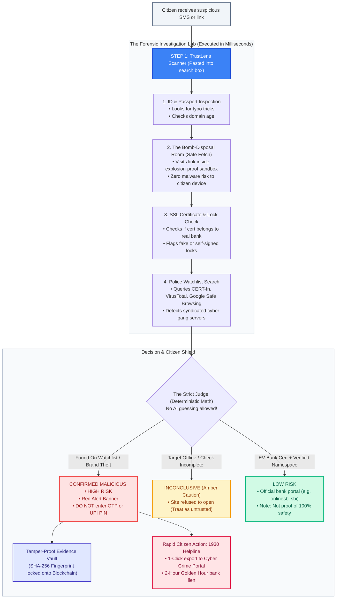
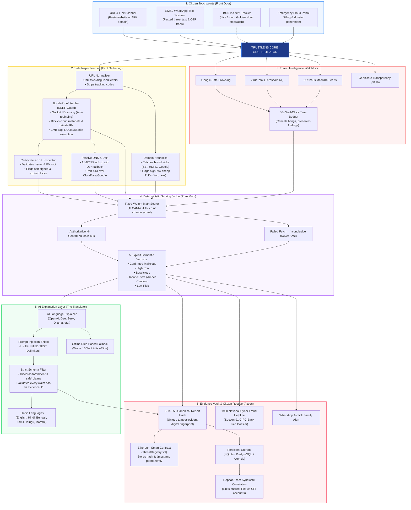

# TrustLens — AI-Powered Web Threat Detection & Digital Trust Intelligence

> **Hackathon MVP (all 6 phases complete + audited & hardened)** — evidence-backed risk reports for
> suspicious URLs, domains, and pasted messages, with on-chain integrity verification.
>
> **Cybersecurity checks produce the facts. A deterministic engine produces the verdict. AI only
> explains. Web3 records tamper-evident commitments.**
>
> The dashboard ships as **TrustLens Bharat**, a citizen-safety edition for Indian users (1930
> helpline framing, bilingual EN/Hindi labels, incident tracker, fraud-reporting wizard). Every
> simulated/demo element in the UI is **explicitly labelled as such** — analysis verdicts, scores,
> findings, and integrity proofs always come from the real pipeline, never from sample data.

TrustLens takes a suspicious URL or a pasted email/SMS/chat message and returns a structured,
evidence-backed report: every finding carries an ID, severity, quoted evidence, and source; the
verdict comes from a deterministic scoring engine (never from the AI); anyone can re-verify a
report's integrity hash against an on-chain registry — including years later, independently.

---

## How TrustLens Works (Visual Guide & Mind Map)

### 1. The Citizen Safety Journey (Step-by-Step Flow)

Think of **TrustLens** as an **Airport Security Scanner + Police Forensic Lab + Notary Public** for suspicious web links and messages.



---

### 2. Connected Ecosystem Mind Map

How all 6 subsystems connect in real-time from link entry to blockchain sealing and 1930 bank fund recovery:



---

## Table of contents

0. [How TrustLens Works (Visual Guide & Mind Map)](#how-trustlens-works-visual-guide--mind-map)
1. [What TrustLens does](#what-trustlens-does)
2. [Status](#status)
3. [Workflows — every user journey in detail](#workflows)
   - [W1 · Scan a link / website](#w1--scan-a-link--website)
   - [W2 · Scan a message / SMS](#w2--scan-a-message--sms)
   - [W3 · Read a report](#w3--read-a-report)
   - [W4 · Commit on-chain & verify](#w4--commit-on-chain--verify)
   - [W5 · Threat Radar, correlation & report management](#w5--threat-radar-correlation--report-management)
   - [W6 · Demo content, sample scans, tracker & fraud wizard](#w6--demo-content-sample-scans-tracker--fraud-wizard)
   - [W7 · Authentication (opt-in)](#w7--authentication-opt-in)
4. [The URL analysis pipeline — stage by stage](#url-analysis-pipeline)
5. [The message pipeline](#message-pipeline)
6. [Scoring & classification policy](#scoring--classification-policy)
7. [Threat-intelligence adapters](#threat-intelligence-adapters)
8. [SSRF-safe fetching & TLS analysis](#ssrf-safe-fetching--tls-analysis)
9. [Passive DNS records & DoH fallback](#passive-dns-records--doh-fallback)
10. [AI explanation layer](#ai-explanation-layer)
11. [Correlation engine](#correlation-engine)
12. [Web3 layer](#web3-layer)
13. [Storage, privacy & multi-tenancy](#storage-privacy--multi-tenancy)
14. [API reference](#api-reference)
15. [Environment variables](#environment-variables)
16. [Deployment](#deployment)
17. [Testing](#testing)
18. [Security properties](#security-properties)
19. [Known limitations & honest-use notes](#known-limitations--honest-use-notes)
20. [Repo structure](#repo-structure)

Docs: [docs/architecture.md](docs/architecture.md) · [docs/methodology.md](docs/methodology.md) ·
[docs/testing-report.md](docs/testing-report.md) (observed runs, raw responses in
[docs/case-runs/](docs/case-runs/)) · [docs/audit-2026-11-09.md](docs/audit-2026-11-09.md)
(three audit rounds, all findings fixed — see the §10 addendum)

---

## What TrustLens does

| Capability | Detail |
|---|---|
| **URL normalisation** | Scheme validation (http/https only), IDN→punycode, IP-literal de-obfuscation (decimal/hex/octal), invisible-character stripping, tracking-param removal, eTLD+1 extraction (offline Public Suffix List) |
| **SSRF-safe fetcher** | DNS resolved + validated *inside* the TCP connect step (IP pinning — no rebinding window) for the initial URL **and every redirect hop**; private/loopback/link-local/metadata/CGNAT/benchmark/reserved ranges blocked (IPv4 and IPv6, incl. NAT64/6to4/Teredo and the deprecated IPv4-compatible form); **fail-closed**: if the pinning transport cannot be built, every fetch is refused before any request; manual redirect tracing (max 5 hops, re-validated per hop); 1 MB body cap; no JS execution; no downloads; ports 80/443 only |
| **TLS analysis** | Full peer-presented chain capture on every supported runtime (pyOpenSSL memory-BIO layer on CPython 3.11/3.12, native `get_unverified_chain` on 3.13+), then **independent re-verification**: signatures (RSA PKCS#1 v1.5 **and RSASSA-PSS** via the certificate's own hash/MGF1/salt parameters, ECDSA, Ed25519/Ed448, DSA), validity windows, BasicConstraints, distrusted-CA screening of **every** chain certificate; SAN-vs-hostname matching wildcard-aware, against the **final** redirect host |
| **DNS records (passive)** | A/MX/NS/TXT via dnspython; on failure, RFC 8484 **DNS-over-HTTPS** fallback (Cloudflare → Google → Quad9, 2 s per endpoint); NXDOMAIN is definitive and never retried; evidence sanitised (names max 3, TXT count + SPF flag only — raw TXT never stored) |
| **Certificate Transparency** | crt.sh lookup: recency (calibrated to small footprints), issuance bursts, volume (informational), issuer diversity |
| **Passive header checks** | HSTS/CSP/framing/nosniff, version disclosure, cookie flags (names only — cookie **values** are never stored), plain HTTP, mixed content; hardening gaps informational |
| **Threat intel** | GSB v4, URLhaus v1, OpenPhish community feed, PhishTank v2 (verified+valid only), VirusTotal v3 (with passive domain fallback on 404); adapters per official docs, keys never in URLs; whole stage under a wall-clock budget (`TRUSTLENS_INTEL_BUDGET_SECONDS`, default 60 s); TTL+size-bounded caches; failures never cached as clean |
| **Deterministic scoring** | Weighted findings → classification; authoritative feed hits → Confirmed Malicious (takes precedence); **required** check failures (page fetch; all-configured-feeds outage) → Inconclusive; **optional** failures recorded but non-gating; thresholds fixed in code |
| **AI explanations** | OpenAI-compatible LLM client (OpenAI/DeepSeek/Kimi/GLM/OpenRouter/Ollama); strict JSON-schema output; every claim must cite finding IDs (unsupported claims stripped everywhere — incl. the summary, which falls back on violation); prompt-injection defences; rule-based fallback with zero configuration |
| **Message analysis** | Entity extraction (URLs/emails-as-counts/phones-as-counts/payment demands), 7 social-engineering tactic families with quoted evidence, OTP-request detector, embedded URLs run the full pipeline as persisted sub-reports; aggregate message budget (default 240 s) |
| **Web3 registry** | `ThreatRegistry.sol` (Solidity 0.8.24): `submitReport` / `getReport` / `updateStatus` (reporter-only, contract-level) / `verify` / revisions; public verify UI + API; tamper detection |
| **Correlation** | Rule-based only: indicator store (domain/IP/issuer/message-hash), exact-match linking, TF-IDF cosine ≥ 0.25 over report text; in multi-tenant mode lookups are scoped to reports the caller may read; prior high-risk history yields `CORR-PRIOR-MALICIOUS` |
| **Multi-tenant auth (opt-in)** | Bearer JWT (purpose-scoped: access / email-verify / password-reset) + X-API-Key (SHA-256-hashed at rest); hardened admin bootstrap; ownership matrix (owner-or-public reads, 404 hides foreign private reports, owner-only delete/commit); the dashboard shows a sign-in control in the header; default off = frictionless demo mode |
| **Persistence** | SQLAlchemy: SQLite by default, PostgreSQL-ready via one env var (Alembic migrations run fail-closed at startup on PostgreSQL) |

### Classification bands

| Verdict | Meaning |
|---|---|
| `low_risk` | "No significant indicators found in the available checks" — **never** claimed as "safe" |
| `suspicious` | Indicators of concern; verify the destination independently |
| `high_risk` | Strong indicators (any high-severity finding or score ≥ 20) — do not enter credentials/payments |
| `confirmed_malicious` | Authoritative threat-intel hit (URLhaus, PhishTank verified+valid, OpenPhish, GSB malware/phishing, VT ≥ 6 engines) |
| `inconclusive` | A **required** check failed (page fetch; or every configured threat-feed was unavailable) — a coverage limitation, **never** a safe verdict |

**VT miss policy:** when the exact URL was never analysed (404), the adapter passively falls back to
the **domain object** (`TRUSTLENS_VT_DOMAIN_FALLBACK`, default on); a URL match or a domain match
with ≥ 8 malicious engines is authoritative, weaker domain matches surface as non-authoritative
`VT-LOW-CONFIDENCE`/`domain_positives=` evidence. `TRUSTLENS_VT_SUBMIT_ON_MISS=true` (opt-in)
additionally POSTs unknown URLs to VT for scanning under an hourly budget.

---

## Status

| Layer | State |
|---|---|
| URL pipeline (normalise → safe-fetch → TLS → CT → DNS records → headers → heuristics → intel → score → explain → correlate) | ✅ |
| Message pipeline (entities → tactics → OTP → embedded-URL sub-reports, budgets) | ✅ |
| React dashboard — Bharat edition (Scan & Check / Tracker / Threat Radar & Reports / Report Fraud / Verify On-Chain, EN/हिंदी toggle, AuthBar) | ✅ |
| Web3 threat registry + commit/verify + supplied-report verification | ✅ |
| Docker Compose (chain → deploy → backend → frontend/nginx) | ✅ tested end-to-end, rebuild-verified |
| Security audit rounds (2026-11-08/09) | ✅ all findings fixed & regression-tested (`docs/audit-2026-11-09.md` §10) |

---

## Workflows

The UI is a single-page React app (React 19 + Vite + TypeScript, Tailwind v4). Five routes:

| Route | Page | Purpose |
|---|---|---|
| `/` | **Scan & Check** (SubmitPage) | URL and message analysis; sample scenarios; live recent-scans strip |
| `/tracker`, `/tracker/:id` | **1930 Incident Tracker** (TrackerPage) | Simulated complaint/freeze status for demo records (clearly labelled) |
| `/reports` | **Threat Radar & Reports** (ReportsListPage) | Stored reports list (metadata only) |
| `/reports/:id` | **Full report** (ReportPage) | The complete evidence dossier |
| `/report-fraud` | **Report Fraud** (ReportFraudPage) | Demo victim-guidance wizard (local record only, clearly labelled) |
| `/verify` | **Verify On-Chain** (VerifyPage) | Integrity + on-chain verification (3 modes) |

All frontend→backend traffic goes through `/api` and `/health` — Vite dev proxy in development,
nginx `proxy_pass` in Docker. Errors arrive as `{"error": {"code", "message"}}` and every page
surfaces `code: message`. When `TRUSTLENS_AUTH_REQUIRED=true`, the header AuthBar offers sign-in;
the access token lives in memory mirrored to `sessionStorage` (tab-only — never `localStorage`) and
the API client attaches `Authorization: Bearer …` to every call, returning to the logged-out state
on 401.

### W1 · Scan a link / website

1. On **Scan & Check**, keep the *Scan Link / Website* tab active and paste a URL (or use the
   *Paste* button to read the clipboard). Sample buttons fill the input with illustrative
   scenarios.
2. **Analyze Website** POSTs `{ "url": … }` to `POST /api/v1/analyze/url` (limits: 3–2048 chars).
3. The backend runs the [URL pipeline](#url-analysis-pipeline) (stages 1–9 below) and returns a
   full `AnalysisReport` (v2.1 schema). Typical wall-clock: a few seconds for reachable sites;
   up to ~40 s fetch budget + 60 s intel budget on slow targets; DNS-dead targets fail fast with
   an honest `FETCH-DNS-FAIL`.
4. The result card shows the verdict badge (e.g. `CONFIRMED MALICIOUS`, `INCONCLUSIVE —
   INCOMPLETE CHECKS`), the **real** provenance ("Scanned 3 min ago", computed from the report's
   `created_at`; sample scenarios are labelled *"Sample scenario — illustrative data, not a live
   scan"*), a classification-aware advice strip, and four data pillars driven by the report's own
   fields: threat analysis (rationale + deterministic score), web security (fetch outcome), TLS
   (issuer / self-signed / validity), threat intel (finding + authoritative-hit counts and the
   honest per-provider note).
5. **Full Forensic Dossier →** opens the persisted report at `/reports/{id}` ([W3](#w3--read-a-report)).
   WhatsApp **Share Alert** composes a verdict-appropriate message (a `low_risk` result never
   sends "do NOT open" wording). **Report Domain** deep-links into the fraud wizard.
6. Safety note baked into the flow: targets like `http://192.0.2.1/` (documentation ranges) are
   refused by SSRF policy **before any packet is sent** and render as `inconclusive` with
   `FETCH-BLOCKED-POLICY` — the platform never becomes a probing tool.

### W2 · Scan a message / SMS

1. Switch to *Scan Message / SMS Text* and paste the message (8–20 000 chars).
2. **Analyze** POSTs to `/api/v1/analyze/message`. The backend extracts entities (URLs, payment
   demands; emails/phones are counted, **never stored**), tags tactic families with quoted
   phrases, and fires the OTP-request detector.
3. Every extracted URL (cap 10) is run through the **full URL pipeline as a persisted sub-report**
   (shared fetcher + intel registry; aggregate budget `TRUSTLENS_MESSAGE_URL_BUDGET_SECONDS`,
   default 240 s — URLs past it are skipped as `MSG-URL-SKIPPED`, never treated as clean).
4. The verdict gate: when embedded URLs exist, the embedded-URL fetch is a required check — if
   **every** URL failed to fetch (or was unparsable/skipped), the message is `inconclusive`;
   partial failures stay scorable. Authoritative feed hits inherited from sub-reports can drive
   `confirmed_malicious` (message findings are deduplicated on `(id, evidence)` so a weak finding
   can never mask a stronger one).
5. The report page shows entity **counts** (privacy), quoted tactics, embedded-URL sub-report
   links (retrievable forever), and the same scoring/intel summaries as URL reports.

### W3 · Read a report

`/reports/{id}` renders the full dossier:

- **Header** — risk badge, REF (report id), timestamp, target, deterministic rationale, actions
  (WhatsApp alert, 1930 Cyber Cell deep-link, Commit to Chain, Correlate, Delete).
- **Citizen guidance strip** (`RiskHint`) — wording matched to the exact verdict band
  (`low_risk` explicitly says *not proof of safety*; `inconclusive` says *unknown, not safe*).
- **Score grid** — deterministic score (pts), high hits, authoritative-feed hits, checks
  completed (`n / attempted`, attempted is 10 for URLs, 3 for messages).
- **AI/rule-based explanation** — evidence-backed claims citing finding IDs, recommended actions,
  `Model:` label (`rule-based-fallback` when no LLM key), stripped-claim count.
- **Forensic findings table** — every finding with severity chip, stable ID, `Verified` vs
  `Skipped / Inconclusive` (`check_succeeded`), expandable quoted evidence.
- **Redirect chain** — per-hop URL/status/resolved-IPs/notes (e.g. TLS-downgrade flags).
- **TLS inspector** — issuer, key type/size, signature algorithm, SANs, expiry, `cert_sha256`,
  capture method + independent verification note.
- **CT history, DNS records, threat-intel provider rows** (each shows
  active/unconfigured/rate-limited/failed — configuration state, never "clean"), coverage with
  `unavailable_checks`, recommended actions, limitations.
- **Integrity card** — canonical SHA-256, on-chain commitment status, **Copy report JSON**,
  **Delete report**.

### W4 · Commit on-chain & verify

**Commit** (report page button or `POST /api/v1/reports/{id}/commit`): the backend recomputes the
canonical hash from the *stored* report and refuses on mismatch (`409 integrity_mismatch` —
post-analysis tampering) or duplicate (`409 already_committed`), then signs and sends
`submitReport(bytes32,string)` to ThreatRegistry, persisting the receipt (tx hash, block, gas,
chain id). Without chain configuration the endpoint degrades gracefully (`503 chain_disabled`).

**Verify — three independent paths** (public; no auth, no submission required):

1. `GET /api/v1/verify/{report_id}` — recompute the stored report's hash, compare with its
   recorded `integrity` field, and read the chain commitment.
2. `GET /api/v1/verify/{0x…}` — look up a raw 32-byte hash on-chain.
3. `POST /api/v1/verify/report` — paste an exported report JSON (schema + ≤ 512 kB validated):
   the server recomputes the hash and reports `integrity_match` (contents match the report's own
   recorded hash), `hash_match` (contents match a caller-supplied expected hash) and
   `on_chain.exists` as **independent facts**, with a note explaining the difference. Only the
   32-byte hash is looked up on-chain — report contents never leave the payload.

The Verify page exposes all three (by ID/hash, or by pasted JSON with an optional expected hash)
and reports "YES/NO" per fact. Example (live-verified): a stored-but-uncommitted report returns
`INTEGRITY CHECK: YES` + `Not found on-chain — no commitment exists for this hash`.

**Chain restart reality:** the local Hardhat node is in-memory — restarting it wipes commitments
(verify then answers `502 chain_unavailable` honestly until you redeploy; the backend re-reads the
deployment file and rebinds automatically).

### W5 · Threat Radar, correlation & report management

- **Threat Radar & Reports** (`/reports`) lists stored reports — metadata only (no findings, no
  raw input) via `GET /api/v1/reports?limit&offset`. In auth mode users see their own reports,
  admins see all.
- **Correlate** (report page button, `GET /api/v1/correlate/{id}`): exact-match indicator hits
  (domain/IP/issuer/message-hash) with prior classifications, plus TF-IDF text similarity over
  recent reports; prior confirmed/high-risk history surfaces as `CORR-PRIOR-MALICIOUS` (medium).
  Correlation is rule-based only; in auth mode it is scoped to reports the caller may read
  (foreign private reports are invisible — existence is not leaked).
- **Delete** (`DELETE /api/v1/reports/{id}`) removes the report, its correlation indicators, and
  its chain-commitment record. Owner/admin only (403 otherwise). `PATCH /api/v1/reports/{id}`
  toggles `is_public` (owner/admin). `TRUSTLENS_REPORT_RETENTION_DAYS=N` purges everything older
  than N days at startup (0 = keep).

### W6 · Demo content, sample scans, tracker & fraud wizard

The Bharat edition includes demo surfaces for presentations. **All of them are labelled**, and
none of them can be mistaken for pipeline output:

- **Sample scenarios** on Scan & Check are static datasets with `demo-` report IDs; the card shows
  *"Sample scenario — illustrative data, not a live scan"*. Running **Analyze** on any URL —
  including a sample URL — always executes the real pipeline and replaces the sample with the real
  report; a failed/unreachable backend shows a real error, never a fabricated verdict.
- **Trending scam patterns** section = educational awareness content (labelled), not telemetry.
  The **Recently Scanned Targets** strip next to it is real (`GET /api/v1/reports`).
- **1930 Incident Tracker** stores demo records in `localStorage` and simulates complaint/freeze
  steps. Every simulated action says so ("simulated — not an official NCRP number", "no bank was
  contacted"), the page banner says nothing is filed anywhere, and references use `TL-DEMO-…`.
- **Report Fraud wizard** creates a local demo record only; the coordination seal is relabelled
  *"Demonstration interface … NOT an official government service — nothing is transmitted to 1930,
  cybercrime.gov.in, or any bank"*. Real-victim guidance (call 1930 within the Golden Hour) is
  repeated wherever it matters.
- **Language toggle** (EN/हिंदी) swaps UI copy via `LanguageContext` — analysis content (findings,
  evidence, explanations) always comes from the backend in English.

### W7 · Authentication (opt-in)

Default is **demo mode** (`TRUSTLENS_AUTH_REQUIRED=false`): no credentials needed, everything
works, valid credentials still attach ownership. With auth enabled:

1. **Bootstrap** — set `TRUSTLENS_INITIAL_ADMIN_EMAIL`/`_PASSWORD` (applied idempotently at
   startup, or `python -m app.storage.seed`). Admin rights come **only** from the seed — never
   from the first arbitrary registration. A fresh deployment with an empty user table allows
   exactly one bootstrap registration with role `user` so it can never deadlock.
2. **Register / sign in** — `POST /auth/register` (gated by `TRUSTLENS_ALLOW_OPEN_REGISTRATION`,
   admin creation, or the bootstrap exception; the policy check runs before the email-existence
   check, so closed deployments never reveal which emails exist) returns a bearer token, an API
   key **shown exactly once**, and an email-verification token. `POST /auth/token` logs in.
3. **Programmatic access** — `X-API-Key: tl_…` (256-bit, only the SHA-256 hash is stored).
4. **Lifecycle stubs** (no mailer in the MVP): `POST /auth/verify-email` consumes a 24-h
   purpose-scoped token; `POST /auth/password-reset/request` mints a 15-min reset token (returned
   in dev mode; mintable by an operator via `python -m app.storage.seed --reset-token <email>`;
   discarded in production until a mailer exists; responses never reveal whether an email exists);
   `POST /auth/password-reset/confirm` applies it. Tokens carry a `purpose` claim — a token
   minted for one purpose is rejected for every other.
5. **Authorization matrix** — analyze attaches `owner_id` (sub-reports inherit); `GET /reports`
   filters by owner (admins see all); `GET /reports/{id}` allows owner, `is_public` reports, or
   admins (foreign private reports answer **404** — existence is not leaked); `DELETE`/`commit`
   are strictly owner/admin (403); `GET /verify/*` and `POST /verify/report` stay public.

---

## URL analysis pipeline

Every URL analysis (`POST /analyze/url`) runs these stages in order; `coverage` records all ten
attempted stages with `completed_checks` / `unavailable_checks` (failed optional checks are listed,
never treated as clean):

1. **Normalise** (`pipeline/normalizer.py`) — parse & validate: http/https only; length cap 2048;
   IDN→punycode; IP-literal de-obfuscation (decimal/hex/octal forms resolve to the real dotted
   address); invisible/bidi character stripping; tracking-parameter removal; fragment dropped;
   offline eTLD+1 via bundled Public Suffix List (tldextract). Anything unparsable → `400
   invalid_url`.
2. **Safe fetch** (`pipeline/fetcher.py` + `pipeline/ssrf.py`) — see
   [SSRF-safe fetching](#ssrf-safe-fetching--tls-analysis). Produces per-hop records
   (`redirect_chain`), the captured certificate chain, capped response headers, and an honest
   error taxonomy (`FETCH-DNS-FAIL`, `FETCH-BLOCKED-POLICY`, `FETCH-FAILED`,
   `FETCH-TOO-MANY-REDIRECTS`, `FETCH-TLS-DOWNGRADE`, `FETCH-SIZE-CAP`, `FETCH-TIMEOUT`).
3. **TLS analysis** (`pipeline/tls.py`) — parse the presented certificate(s): subject/issuer, key
   type & size, signature algorithm, SAN coverage for the exact final-host name (wildcard-aware,
   CN fallback only when no SAN exists), expiry windows (`TLS-EXPIRED`, `TLS-EXPIRY-IMMINENT`),
   self-signed detection, weak-key/weak-signature flags, distrusted-CA screening of every chain
   certificate, plus the independent re-verification described below (`chain_verified`).
4. **CT history** (`pipeline/crtsh.py`) — crt.sh with a 5-minute cache: `CT-RECENTLY-ISSUED`
   (medium only when the newest cert is < 24 h old **and** the domain has < 10 total records),
   `CT-BURST-ISSUANCE` (≥ 3 inserts in 5 min → medium), `CT-MULTIPLE-ISSUERS` (medium when
   certs-per-CA < 3 — kit rotation), volume informational. crt.sh being slow/502ing degrades to
   "unavailable" honestly.
5. **Domain heuristics** (`pipeline/domain_heuristics.py`, offline & deterministic) —
   Damerau-Levenshtein typosquats vs ~50 brands (excluding official domains incl. major ccTLDs),
   homoglyph folding (Cyrillic/Greek/digit confusables), mixed-script hosts, brand-in-subdomain,
   suspicious-TLD tiers, shorteners, redirect params, credentials-in-URL, IP-literal/private
   targets, URL-shape oddities, executable/archive download links. Keyword findings are suppressed
   on known-official registrable domains to protect precision.
6. **Threat intel** (`pipeline/intel.py`) — fan-out to configured providers (URL pass + registrable
   domain pass) under one wall-clock budget; per-provider status; results cached (TTL 300 s, 512
   entries; failures never cached). See [adapters](#threat-intelligence-adapters).
7. **Header checks** (`pipeline/headers.py`) — passive analysis of the captured response:
   HSTS/CSP/framing/nosniff missing (info), server/X-Powered-By version disclosure (info),
   `Set-Cookie` without Secure (info; cookie **names** only are recorded), plain-HTTP delivery
   (medium), naive mixed-content scan of the capped body excerpt (low).
8. **DNS records** (`pipeline/dns_records.py`) — passive A/MX/NS/TXT on the registrable domain
   (optional stage): NXDOMAIN short-circuits the rest; per-type success/failure findings
   (`DNS-NXDOMAIN`, `DNS-<T>-UNAVAILABLE`); evidence capped/sanitised.
9. **Correlation lookup** (`pipeline/correlation.py`) — prior analyses sharing the domain/IP yield
   `CORR-PRIOR-SEEN` (info) or `CORR-PRIOR-MALICIOUS` (medium, when the history is
   high-risk/confirmed). Reputation history is context, never proof.
10. **Scoring → explanation → persistence** — the deterministic engine classifies
    ([policy](#scoring--classification-policy)), the LLM/rule-based explainer produces the
    explanation (cannot alter the verdict), the report is persisted with integrity hash, and
    correlation indicators are recorded.

## Message pipeline

`POST /analyze/message` (`pipeline/message.py`):

1. **Entity extraction** — URLs (scheme-less `www.` normalised, trailing punctuation stripped,
   cap 10), emails and phones (**counts only** — never stored, never sent to the LLM), payment
   indicators (crypto, gift cards, wires, P2P, card details, generic demands).
2. **Language analysis** — 7 tactic families (urgency, threat_or_consequence, impersonation,
   credential_harvesting, too_good_to_be_true, secrecy, authority_pressure) tagged with **quoted
   phrases**; `MSG-LANGUAGE-TACTICS` (low). Persuasive language alone never labels fraud.
3. **Escalators** — `MSG-OTP-REQUEST` (high): no legitimate company asks users to relay one-time
   codes. `MSG-PAYMENT-PRESSURE` (medium): payment method paired with urgency/secrecy.
4. **Embedded URLs** — each runs the full URL pipeline and is **persisted as an independent
   report** (`extras.sub_reports` links stay retrievable); their findings are lifted into the
   message report and deduplicated on `(id, evidence)` — identical evidence collapses, a stronger
   same-id finding is preserved so verdicts keep the same evidence bar as URLs. Malformed URLs →
   `MSG-URL-INVALID`; budget-exceeded → `MSG-URL-SKIPPED` (`TRUSTLENS_MESSAGE_URL_BUDGET_SECONDS`,
   default 240 s; both carry `check_succeeded=false`).
5. **Coverage & gate** — attempted 3 (`message-entity-extraction`, `language-analysis`,
   `embedded-url-analysis`); when embedded URLs exist, the embedded-URL fetch is required: if
   *every* URL is unfetched/unparsable/skipped → `inconclusive`; partial failures stay scorable.
   Message reports carry the same truthful `scoring` / `threat_intel` summaries as URL reports.

## Scoring & classification policy

- **Weights** (`pipeline/scoring.py`): info 0 · low 2 · medium 5 · high 8 · critical 12;
  INTEL-category findings count **double**; an explicit non-zero `finding.weight` overrides.
- **Authoritative rules** (single hit ⇒ `confirmed_malicious`, decided on evidence keys):
  GSB `MALWARE`/`SOCIAL_ENGINEERING`/`POTENTIALLY_HARMFUL_APPLICATION` (`THREAT_TYPE=`-prefixed
  evidence only — a URL merely containing "MALWARE" cannot trigger it), URLhaus match,
  OpenPhish community-feed match, PhishTank **verified+valid** entry, VirusTotal
  `positives ≥ 6` (domain-fallback matches need ≥ 8 malicious engines; weaker ones use the
  `domain_positives=` key the authority rule cannot see).
- **Required checks** (failure ⇒ `inconclusive`): `page-fetch` — declared by the caller (a
  verdict without a completed fetch is never issued; in messages the gate fires only when *every*
  embedded URL is unfetched); `threat-intel` — when at least one provider is **configured**, at
  least one must answer (a clean no-hit is an answer; transport/ratelimit/key failures and a
  budget timeout with no earlier answer are not).
- **Optional checks** (failure recorded, verdict unchanged): tls-analysis, ct-history,
  dns-records, header-checks, correlation, unconfigured providers. They appear in
  `coverage.unavailable_checks` and `scoring.key_checks_unavailable`, are excluded from counts and
  score, and never change the band.
- **Precedence:** `confirmed_malicious` > `inconclusive` > risk bands. A failed check can never
  produce a *benign* verdict; feed-confirmed evidence stays actionable.
- **Bands:** any high finding or score ≥ 20 → `high_risk`; any medium/low or score ≥ 8 →
  `suspicious`; nothing above informational → `low_risk`.
- **Summaries are engine-truthful:** `scoring.authoritative_hits` (count) and
  `threat_intel.authoritative_hits` (IDs) come from the engine's actual fired rules — never a
  severity proxy.

## Threat-intelligence adapters

All adapters: keys never in URLs (header or POST-body auth only), TTL 300 s / 512-entry bounded
caches, failures never cached as clean, per-provider status in every report
(`active`/`unconfigured`/`rate_limited`/`failed`) and in `/api/v1/meta`.

| Provider | API & auth | Authority rule | Degradation |
|---|---|---|---|
| Google Safe Browsing v4 | `threatMatches:find` (documented `client`+`threatInfo` body), `key` query-parameter auth — the endpoint refuses header-based identity; only the 4 valid v4 threatTypes | `MALWARE`/`SOCIAL_ENGINEERING`/`POTENTIALLY_HARMFUL_APPLICATION` | 403 → `GSB-KEY-ERROR`; 429 → 60 s backoff; malformed → failed check |
| URLhaus v1 (abuse.ch) | `POST /v1/url/` + `/v1/host/`, form-encoded, `Auth-Key` header | any URL/host object match | object-response parsing; failures → `URLHAUS-ERROR` |
| OpenPhish community feed | keyless feed `feed.openphish.com/v3/feed.txt`, cached ≤ 5 min; any non-empty `TRUSTLENS_OPENPHISH_API_KEY` value acts as the opt-in switch (never sent anywhere) | feed match | feed-fetch failure → `OPENPHISH-ERROR` (never cached as clean) |
| PhishTank v2 | `POST checkurl.phishtank.com/api/v2/checkurl/`, key in body | **verified AND valid** entries only | in-database but unverified/invalid → `PHISHTANK-UNVERIFIED` (info) |
| VirusTotal v3 | `GET /api/v3/urls/{id}` then `/api/v3/domains/{name}`, `x-apikey` header | URL ≥ 6 adverse engines; domain fallback ≥ 8 malicious; weaker domain matches → `VT-LOW-CONFIDENCE` | both missing → `VT-NODATA` (info, never clean); 401/403 → `VT-KEY-ERROR`; 429 → `VT-RATELIMIT`; optional submit-on-miss with hourly budget |

**Stage budget:** `TRUSTLENS_INTEL_BUDGET_SECONDS` (default 60 s, `0` disables) wraps the whole
stage (domain pass + URL pass). On expiry the remaining provider checks are cancelled and recorded
as failed coverage (`INTEL-BUDGET-EXCEEDED`); findings and authoritative matches obtained before
the timeout are preserved; a timeout with no earlier answer keeps the outage ⇒ `inconclusive` rule.

## SSRF-safe fetching & TLS analysis

The fetcher is the security boundary — the platform must never become a probing tool:

- **IP pinning inside the connect step.** A custom httpcore network backend
  (`_PinningNetworkBackend`) resolves + validates the host and dials the validated IP **directly**
  in the same connect call — there is no resolve-then-connect rebinding window. Every redirect hop
  goes through the same path (scheme/port/userinfo policy re-checked per hop; max 5 hops).
- **Policy layers** (`pipeline/ssrf.py`): hostname blocklist (localhost, metadata hosts, reserved
  suffixes like `.local`/`.internal`/`.corp`/`.home.arpa`); strict hostname charset; full IPv4
  range guards (private, loopback, link-local incl. 169.254.169.254, CGNAT, benchmark,
  documentation, multicast, reserved, deprecated 6to4 relay anycast); full IPv6 guards
  (unspecified, loopback, reserved `::/8` incl. the deprecated IPv4-compatible form, link-local,
  unique-local, multicast, documentation, NAT64 `64:ff9b::/96`, Teredo — the tunnel forms are
  blocked outright and their embedded IPv4 is never dialled); IPv4-mapped addresses are unwrapped
  and re-checked. **Any blocked answer refuses the whole target** (mixed public/private DNS answers
  are a rebinding signal). A post-connect peer check re-classifies the actual socket peer.
- **Fail-closed.** If the pinning transport cannot be constructed, every fetch is refused with a
  POLICY error *before any request* — there is no plain-transport fallback.
- **Bodies.** GET only; ports 80/443 only; 1 MB streaming cap (reading stops at the cap);
  non-textual content types are never read; honest `TrustLensBot` UA; `trust_env=False` (no
  ambient proxies); redirects traced manually with per-hop budgets plus a whole-chain budget.
- **TLS capture on every runtime.** CPython 3.13+ uses the native
  `ssl.SSLObject.get_unverified_chain()` (peer-presented chain preferred — deterministic across
  machines). On 3.11/3.12 a **pyOpenSSL memory-BIO TLS layer** drives the handshake (OpenSSL
  verifies against the system store; SAN/hostname match re-checked explicitly; any failure falls
  back to the stdlib layer with leaf-only capture — TLS security never depends on the capture
  layer, only its completeness does). The buffer is reset per hop so the **final connection's**
  chain is analysed against the final host; the capture method is recorded in every report's
  `tls.note` ("leaf-only" never claimed when nothing was captured).
- **Independent re-verification** (`verify_chain`): signatures from the leaf up every presented
  issuer — RSA PKCS#1 v1.5, **RSASSA-PSS** (verified with the certificate's own encoded
  hash/MGF1/salt parameters), ECDSA, Ed25519/Ed448, DSA — validity windows, BasicConstraints
  (`ca=True` intermediates, `ca=False` leaf); a non-self-signed top-of-chain is normal (the trust
  anchor lives in the system store and was validated during the handshake). Every chain
  certificate is screened against a deliberately conservative distrusted/dead-CA list (Entrust,
  RapidSSL, WoSign, StartCom, Equifax — word-boundary matched so e.g. "entrust" ⊄ "identrust"
  cannot false-positive). Chain-verification failures are honest findings, never silent passes.

## Passive DNS records & DoH fallback

- Read-only A/MX/NS/TXT via dnspython, 3 s budget, parallel queries, NXDOMAIN short-circuits.
- On resolver failure (timeout/refused/network down), each query retries over **RFC 8484 DoH on
  port 443** (Cloudflare → Google → Quad9, 2 s per endpoint). NXDOMAIN is definitive and never
  retried over DoH. Total failure yields the honest `DNS-LOOKUP-FAILED` summary without halting.
- The **fetcher's** pinning resolver deliberately does NOT use DoH — changing the fetch path's
  resolver is a security-sensitive change outside this stage's purpose.
- Evidence is capped and sanitised: address/nameserver names (max 3 each), TXT **count** + SPF
  flag. Raw TXT bodies are never stored or shown.

## AI explanation layer

One OpenAI-compatible client covers OpenAI/DeepSeek/Kimi/GLM/OpenRouter/Ollama via env vars; no
key or any provider failure ⇒ deterministic rule-based explanation (same shape, zero network).

1. The model receives **only** structured findings JSON — never raw page HTML, never raw message
   bodies, never extracted email addresses or phone numbers.
2. Untrusted strings (evidence lines, unicode hosts, extracted URLs) are sanitised —
   delimiter-smuggling sequences and control characters stripped *before* wrapping — then wrapped
   in `<UNTRUSTED-TEXT>` markers the system prompt declares data-only.
3. Output must validate against a strict JSON schema (`additionalProperties: false`, length caps).
4. Unsupported statements are stripped **everywhere**: claims citing no valid finding ID; safety
   claims ("is safe" is forbidden outright); malice claims the deterministic verdict does not
   back; and an unsupported **summary** invalidates the whole reply (rule-based explanation is
   served instead). The strip count is surfaced in the UI.
5. The classification is copied from the deterministic engine — the LLM structurally cannot change
   the verdict. The API key lives only in the `Authorization` header and is never logged.

## Correlation engine

- Indicators recorded per persisted report: registrable domain + host, resolved IPs, TLS issuer
  CN, message text SHA-256.
- Matching: exact indicator equality across reports; text similarity via TF-IDF cosine (pure
  Python IDF, threshold 0.25).
- Escalation: an indicator previously seen in `confirmed_malicious`/`high_risk` analyses yields
  `CORR-PRIOR-MALICIOUS` (medium); any other repeat yields `CORR-PRIOR-SEEN` (info). Reputation
  history is explicitly labelled context, not proof. The AI never decides relationships.
- **Multi-tenant scoping:** the indicator/text lookups accept a visibility scope; in auth mode
  (non-admin) they match only the caller's own + public reports — foreign private report IDs (the
  capability addresses that gate anonymous reads), classifications, and similarity can never leak
  through correlation, and the same scoping applies to the correlation snapshot persisted at
  analysis time.

## Web3 layer

- `ThreatRegistry.sol` (Solidity 0.8.24): `submitReport(bytes32,string)` (zero-hash/empty-
  category/duplicate reverts), `getReport`, `verify`, `getRevisionCount`/`getRevision`, and
  `updateStatus` — reporter-only via custom errors, every change appended to an auditable revision
  trail. Governance beyond reporter-only is a documented MVP trade-off (the backend client exposes
  no update route; status management is contract-level).
- **Committed value:** SHA-256 of the report's **canonical JSON** (sorted keys, compact
  separators, `ensure_ascii=false`, excluding the regenerable `explanation` and the `integrity`
  carrier itself) plus a fixed category tag (`url-analysis` / `message-analysis`). Content (URLs,
  message text, personal data) never goes on-chain. The hash computation is shared by runner and
  registry client — commit/verify round-trips byte-identically.
- **Commit flow:** recompute from the *stored* report → refuse on mismatch (`integrity_mismatch`)
  or duplicate (`already_committed`) → sign & send → persist receipt (tx hash, block, gas,
  chain id — a `chain_id` read failure after a successful submit no longer loses the receipt).
- **Verify flow:** by report ID / raw `0x` hash / supplied report JSON (three independent facts —
  see [W4](#w4--commit-on-chain--verify)). Public, no submission required.
- **Resilience:** empty-code answers (Hardhat restarted) trigger a deployment-file re-read and one
  automatic rebind; unconfigured chain ⇒ `503 chain_disabled`; unreachable/reverted transactions ⇒
  `502 chain_unavailable`.

## Storage, privacy & multi-tenancy

| Table | Purpose |
|---|---|
| `reports` | Full report JSON + summary columns (+ `owner_id` FK, `is_public` in multi-tenant mode) |
| `chain_commitments` | Per-report receipt (report hash, tx, contract, block, chain id) |
| `correlation_indicators` | `(kind, value, report_id, classification)` rows |
| `users` | email (unique), PBKDF2 hash, API-key hash (nullable, unique), role, `email_verified`, `updated_at` |

- **Privacy model (capability-addressed, redacted-at-source):** report IDs are unguessable
  128-bit values and are the access credential; list endpoints expose metadata only; extracted
  emails/phones are stored as **counts only**; only a 500-char message excerpt is stored; fetched
  page bodies are never persisted; cookie **names** (not values) are kept; raw TXT records never
  leave the resolver path; on-chain payloads are hash + category tag only.
- **Deletion & retention:** `DELETE /api/v1/reports/{id}` cascades indicators + commitment;
  `TRUSTLENS_REPORT_RETENTION_DAYS=N` purges everything older than N days at startup.
- **Schema management:** PostgreSQL runs Alembic migrations at startup, fail-closed on error;
  SQLite keeps create_all + an idempotent in-place column fallback.
- **Report integrity:** the canonical hash is computed after the explanation exists (explanation
  is regenerable and excluded) and covers everything else; ownership/visibility live **outside**
  the report JSON so the hash is unaffected.

## API reference

Base URL: `http://127.0.0.1:8000` · All errors: `{"error": {"code", "message"}}` · Rate limit:
10 req/min per IP on `/api/*` by default (429 + `Retry-After`; 100/min in compose; key = rightmost
`X-Forwarded-For` entry when `TRUST_PROXY_HEADERS=true`). Auth mode: attach `Authorization: Bearer
<jwt>` or `X-API-Key`.

| Method | Path | Auth | Description |
|---|---|---|---|
| `GET` | `/health` | — | Liveness + version |
| `GET` | `/api/v1/meta` | — | Pipeline stages, integration availability, per-provider intel statuses (no key material) |
| `POST` | `/api/v1/analyze/url` | demo: none / auth: required | `{ "url": "…" }` (3–2048 chars) → full `AnalysisReport` |
| `POST` | `/api/v1/analyze/message` | demo: none / auth: required | `{ "message": "…" }` (8–20 000 chars) → report with entities/tactics + embedded-URL sub-reports |
| `GET` | `/api/v1/reports?limit&offset` | demo: all / auth: own (admin: all) | Stored reports — summary list, metadata only |
| `GET` | `/api/v1/reports/{id}` | owner, `is_public`, or admin (else **404**) | Full stored report |
| `PATCH` | `/api/v1/reports/{id}` | owner/admin | `{ "is_public": true|false }` — visibility toggle (403 for others) |
| `DELETE` | `/api/v1/reports/{id}` | owner/admin | Delete report + indicators + commitment (403 for others) |
| `POST` | `/api/v1/reports/{id}/commit` | owner/admin (demo: capability) | Recompute canonical hash → commit to ThreatRegistry → `{tx_hash, block_number, gas_used, chain_id}`; 409 `already_committed`/`integrity_mismatch`; 503 chain off; 502 chain down |
| `GET` | `/api/v1/verify/{id_or_0xhash}` | public | Recompute/look up hash → integrity match + on-chain state |
| `POST` | `/api/v1/verify/report` | public | Verify supplied report JSON (schema + ≤ 512 kB): `integrity_match`, `hash_match`, `on_chain.exists` as independent facts |
| `GET` | `/api/v1/correlate/{id}` | readable-report rule | Shared-indicator hits + TF-IDF text matches (visibility-scoped in auth mode) |
| `POST` | `/api/v1/auth/register` | policy-gated | Create user (role `user`; admins only via seed). Returns token + API key **once** + verification token. 403 `registration_closed` before any email check |
| `POST` | `/api/v1/auth/token` | — | Email+password → bearer access token |
| `POST` | `/api/v1/auth/api-key` | required | Rotate/disable the caller's API key (shown once) |
| `GET` | `/api/v1/auth/me` | optional | Caller identity / auth-mode probe (no side effects) |
| `POST` | `/api/v1/auth/verify-email` | — | Consume 24-h `email_verify` purpose token |
| `POST` | `/api/v1/auth/password-reset/request` | — | Mint 15-min `password_reset` token (dev: returned; prod: discarded — no mailer; never reveals email existence) |
| `POST` | `/api/v1/auth/password-reset/confirm` | — | Apply reset token → new password |

Report shape (v2.1, abridged):

```jsonc
{
  "schema_version": "2.1",
  "report_id": "…32 hex…",
  "classification": "high_risk",           // low_risk | suspicious | high_risk | confirmed_malicious | inconclusive
  "findings": [{ "id": "DOM-BRAND-IN-SUBDOMAIN", "severity": "high", "evidence": ["…"],
                 "source": "trustlens/domain-heuristics", "check_succeeded": true }],
  "redirect_chain": [{ "url": "…", "status": 302, "resolved_ips": ["…"], "note": "TLS downgrade: https → http" }],
  "tls": { "issuer_common_name": "…", "days_remaining": 74, "san_dns": ["…"], "cert_sha256": "…",
           "note": "Full peer-presented chain (4 certificates…) was captured and independently re-verified…" },
  "threat_intel": { "providers": {"urlhaus": "active", "phishtank": "unconfigured"}, "authoritative_hits": [],
                    "note": "Absence of intel hits is not proof of safety. …" },
  "scoring": { "score": 13, "high": 1, "medium": 1, "low": 0, "authoritative_hits": 0,
               "key_checks_failed": [], "key_checks_unavailable": [] },
  "coverage": { "attempted": 10, "completed": 8, "completed_checks": ["…"], "unavailable_checks": ["…"] },
  "explanation": { "summary": "…", "claims": [{"claim": "…", "finding_ids": ["…"]}],
                   "generated_by": "rule-based-fallback", "stripped_claims": 0 },
  "extras": { "message": { "extracted_urls": [], "extracted_email_count": 1, "extracted_phone_count": 0,
                           "tactics": [{"tactic": "urgency", "phrases": ["…"]}], "sub_reports": [] },
              "dns_summary": { "A": 2, "MX": 1, "NS": 2, "TXT": 3, "spf": true },
              "correlation": { "shared_indicators": [], "similar_reports": [] } },
  "integrity": { "canonical_json_sha256": "…64 hex…" }   // ← the value committed on-chain
}
```

### Finding ID catalogue

| Prefix | Family | Examples |
|---|---|---|
| `DOM-*` | Domain heuristics | `DOM-TYPOSQUAT`, `DOM-HOMOGLYPH-CONFUSABLE`, `DOM-BRAND-IN-SUBDOMAIN`, `DOM-BRAND-LOOKALIKE-TLD`, `DOM-SUSPICIOUS-TLD`, `DOM-URL-SHORTENER`, `DOM-REDIRECT-PARAM`, `DOM-CREDENTIALS-IN-URL`, `DOM-EXCESSIVE-SUBDOMAINS`, `DOM-IP-LITERAL-HOST`, `DOM-PRIVATE-IP-TARGET`, `DOM-MIXED-SCRIPT-HOST`, `DOM-PUNYCODE-HOST`, `DOM-EXECUTABLE-DOWNLOAD-LINK`, `DOM-LONG-URL`, `DOM-EXCESSIVE-HYPHENS`, `DOM-HEAVY-ENCODING`, `DOM-SUSPICIOUS-KEYWORDS`, `DOM-BRAND-KEYWORD-PATTERN` |
| `FETCH-*` | Safe fetch | `FETCH-DNS-FAIL`, `FETCH-BLOCKED-POLICY`, `FETCH-FAILED`, `FETCH-TLS-DOWNGRADE`, `FETCH-TOO-MANY-REDIRECTS`, `FETCH-SIZE-CAP` |
| `TLS-*` | Certificate | `TLS-WEAK-SIGNATURE`, `TLS-WEAK-KEY`, `TLS-EXPIRED`, `TLS-EXPIRY-IMMINENT`, `TLS-SELF-SIGNED`, `TLS-POLICY` |
| `CT-*` | Cert transparency | `CT-RECENTLY-ISSUED`, `CT-BURST-ISSUANCE`, `CT-HIGH-VOLUME`, `CT-MULTIPLE-ISSUERS`, `CT-CERT-NOT-IN-LOGS`, `CT-NONE-FOUND`, `CT-CACHE-FAIL` |
| `DNS-*` | Passive DNS records | `DNS-RECORDS`, `DNS-NXDOMAIN`, `DNS-LOOKUP-FAILED`, `DNS-A/MX/NS/TXT-UNAVAILABLE` |
| `HEADER-*` | Header checks | `HEADER-PLAIN-HTTP`, `HEADER-MIXED-CONTENT`, `HEADER-HSTS-MISSING`, `HEADER-CSP-MISSING`, `HEADER-COOKIE-NOSECURE`, `HEADER-SERVER-VERSION` |
| `CORR-*` | Correlation | `CORR-PRIOR-SEEN`, `CORR-PRIOR-MALICIOUS` |
| `<PROVIDER>-*` | Threat intel | `URLHAUS-MATCH`, `GSB-MATCH`, `OPENPHISH-MATCH`, `PHISHTANK-MATCH`, `PHISHTANK-UNVERIFIED`, `VT-MATCH`, `VT-LOW-CONFIDENCE`, `VT-NODATA`, `*-UNAVAILABLE`, `*-RATELIMIT`, `*-KEY-ERROR`, `INTEL-BUDGET-EXCEEDED` |
| `MSG-*` | Message analysis | `MSG-LANGUAGE-TACTICS`, `MSG-PAYMENT-PRESSURE`, `MSG-OTP-REQUEST`, `MSG-TRUNCATED`, `MSG-URL-INVALID`, `MSG-URL-SKIPPED` |

---

## Environment variables

All prefixed `TRUSTLENS_`, loaded from `backend/.env` (see
[backend/.env.example](backend/.env.example)). Env vars take precedence over the file; the file is
located absolutely (launching uvicorn from any directory loads the same config; **restart uvicorn
after editing it** — settings are cached).

| Variable | Default | Purpose |
|---|---|---|
| `DATABASE_URL` | `sqlite:///./trustlens.db` | SQLAlchemy URL (PostgreSQL: `postgresql+psycopg://…`) |
| `RATE_LIMIT_PER_MINUTE` | `10` | Per-IP limit on `/api/*` |
| `TRUST_PROXY_HEADERS` | `false` | Honour `X-Forwarded-For` — uses the **rightmost** entry (appended by the trusted proxy); only enable behind a proxy you control |
| `FETCH_MAX_REDIRECTS` | `5` | Redirect hop cap |
| `FETCH_CONNECT_TIMEOUT` / `FETCH_READ_TIMEOUT` | `5.0` / `10.0` | Per-hop timeouts (s) |
| `FETCH_TOTAL_BUDGET` | `40.0` | Whole-chain fetch budget (s) |
| `INTEL_BUDGET_SECONDS` | `60.0` | Wall-clock budget for the threat-intel stage of one URL analysis (domain + URL pass); expiry ⇒ failed coverage (`INTEL-BUDGET-EXCEEDED`), earlier answers kept; `0` disables |
| `MESSAGE_URL_BUDGET_SECONDS` | `240.0` | Aggregate budget for running a message's embedded URLs through the full pipeline; URLs past it are skipped (`MSG-URL-SKIPPED`); `0` disables |
| `FETCH_MAX_BYTES` | `1000000` | Response body cap (bytes) |
| `ALLOWED_FETCH_PORTS` | `[80,443]` | Fetchable ports |
| `CHAIN_RPC_URL` | `http://127.0.0.1:8545` | Chain RPC endpoint |
| `REGISTRY_ADDRESS` | *(empty = chain off)* | ThreatRegistry address |
| `DEPLOYMENT_FILE` | *(empty)* | Optional Hardhat deployment JSON to auto-discover the address (compose wiring); re-read automatically after a chain restart |
| `CHAIN_PRIVATE_KEY` | *(empty)* | Signer key — **local test chains only** |
| `LLM_API_KEY` | *(empty = rule-based explainer)* | Any OpenAI-compatible provider |
| `LLM_BASE_URL` | `https://api.openai.com/v1` | Provider endpoint |
| `LLM_MODEL` | `gpt-4o-mini` | Model id |
| `LLM_TIMEOUT_SECONDS` | `25.0` | LLM read timeout |
| `REPORT_RETENTION_DAYS` | `0` (keep) | Purge reports + indicators + commitments older than N days at startup |
| `DNS_USE_DOH` | `true` | RFC 8484 DoH fallback (port 443; Cloudflare → Google → Quad9) for the passive record checks |
| `DNS_TIMEOUT` | `3.0` | Per-query budget for DNS record lookups (s) |
| `VT_DOMAIN_FALLBACK` | `true` | On URL 404, query the VT domain object (passive) |
| `VT_SUBMIT_ON_MISS` | `false` | Opt-in: POST unknown URLs to VT for scanning (hourly budget) |
| `AUTH_REQUIRED` | `false` | Multi-tenant auth gate (JWT / X-API-Key) |
| `JWT_SECRET` | *(empty)* | HS256 signing secret — ≥ 32 bytes (RFC 7518); empty + auth on ⇒ ephemeral secret with a warning (tokens do not survive restarts) |
| `ACCESS_TOKEN_EXPIRY_MINUTES` | `480` | Bearer token lifetime |
| `ALLOW_OPEN_REGISTRATION` | `false` | Self-registration when auth is enabled (admins always can create users) |
| `INITIAL_ADMIN_EMAIL` / `INITIAL_ADMIN_PASSWORD` | *(empty)* | Bootstrap admin, applied idempotently at startup or via `python -m app.storage.seed` — never the first arbitrary registration |

(Threat-intel keys — `GOOGLE_SAFE_BROWSING_API_KEY`, `URLHAUS_API_KEY`, `OPENPHISH_API_KEY`,
`PHISHTANK_API_KEY`, `VIRUSTOTAL_API_KEY` — are read by the intel adapters. GSB v4 authenticates
with its documented `key` query parameter (the endpoint refuses header-based identity); VT v3
authenticates via the `x-apikey` header; the OpenPhish adapter uses the keyless community feed — any
non-empty `TRUSTLENS_OPENPHISH_API_KEY` value (e.g. `community`) just acts as the opt-in switch. See
[docs/methodology.md §6](docs/methodology.md) for exact endpoints, parsing, and limitations.)

---

## Deployment

### Native development (4 terminals)

```bash
cd contracts && npm install && npm run node          # 1: local Hardhat chain (31337, in-memory)
cd contracts && npm run deploy:local                 # 2: deploy + write deployment.localhost.json (copy address)
cd backend && python -m venv .venv && .venv\Scripts\activate && pip install -r requirements.txt
                                                     #    put TRUSTLENS_REGISTRY_ADDRESS + the chain key in backend/.env
cd backend && uvicorn app.main:app --host 127.0.0.1 --port 8000   # 3: API + docs at /docs
cd frontend && npm install && npm run dev            # 4: http://localhost:5173 (Vite proxies /api + /health → :8000)
```

Health check: `curl http://127.0.0.1:8000/health`. Without chain variables the app still runs
(commit → 503, verify → recomputed hash only — graceful degradation). Without an LLM key the app
uses the rule-based explainer and says so honestly.

### Docker Compose (tested end-to-end; rebuild-verified from clean state)

```bash
docker compose up --build
# frontend  http://localhost:5173   (nginx serving the built SPA, proxying /api + /health)
# backend   http://localhost:8000   (API docs at /docs)
```

Topology: `chain` (Hardhat node + healthcheck) → `deploy` (one-shot; writes
`deployment.localhost.json` to a shared volume; `Exited(0)` is its success state) → `backend`
(auto-discovers the contract address from that file; `TRUSTLENS_REGISTRY_ADDRESS` intentionally
empty so a restarted chain rebinds) + `frontend`. Provider keys reach the container via the
optional `backend/.env` `env_file`; data persists in the `trustlens-data` volume (reports survive
`docker compose restart backend`).

Operational notes (all live-observed):

- **Port shadowing:** the native command binds `127.0.0.1:8000` while compose publishes
  `0.0.0.0:8000`; with both up, loopback requests hit the **native** process (same for :5173 if a
  native Vite dev server runs). Test compose via the LAN IP, in-container (`docker compose exec`),
  or with the native stack stopped.
- **Rebuilds:** `docker compose up -d --build backend` / `--build frontend` pick up code changes;
  a plain `restart` does not.
- **Container env:** `.env` edits need container **recreation** (`up -d`), not restart.
- **Chain restarts** wipe commitments (in-memory node): verify answers `502 chain_unavailable`
  honestly; `docker compose run --rm deploy` redeploys (fresh address) and the backend rebinds via
  the deployment file on its next call. DB commitment receipts persist — re-committing a report
  whose receipt is still stored answers `409 already_committed` by design.
- `docker compose config` (without `-q`) prints resolved env values incl. real keys — never paste
  its output.

### Demo script

With the stack running (backend on :8000 with chain enabled): `./scripts/demo.sh` — submits a
look-alike URL, prints findings, commits on-chain, verifies independently, shows rule-based
correlation, analyses a phishing SMS.

---

## Testing

| Suite | Count (observed) | Command |
|---|---|---|
| Backend (pytest) | **399** (395 pass + 4 live-provider tests that skip unless `TRUSTLENS_LIVE_INTEL_TESTS=1` **and** keys are set) | `cd backend && pytest` (~1 min) |
| Contracts (Hardhat) | **17** | `cd contracts && npx hardhat test` |
| Frontend | type-check + build clean · oxlint 0/0 · vitest **11** (auth token store + API-client auth) | `cd frontend && npm run build && npm run lint && npm run test` |

- **No automated test touches the real internet or a live chain** — every network/chain/DNS
  boundary is faked (FakeResolver, FakeTransport, StubRegistryClient, injected DNS query
  functions, stubbed sync httpx clients, sequenced intel registries). Live behaviour is validated
  by explicit smoke runs recorded in [docs/testing-report.md](docs/testing-report.md).
- Coverage includes: URL normalisation (24), SSRF range/hostname guards + IP-pinning dial
  validation + fail-closed transport (33+), fetcher redirect tracing/error taxonomy/per-hop cert
  capture, domain heuristics incl. benign suppression (37), TLS parsing + SAN wildcards +
  full-chain re-verification + synthetic-cert capture tests, crt.sh dual-schema parsing, passive
  DNS (injected queries), scoring bands/policy (required/optional/outage/precedence), provider
  adapters against documented response shapes (matches, misses, unverified entries, invalid
  credentials, rate limits, server errors, malformed JSON — all stubbed), storage round-trips +
  deletion + retention, API end-to-end (fake network) incl. ownership matrix, PATCH visibility,
  CORS preflight, rate-limiter eviction + rightmost-XFF, chain commit/verify incl. tamper
  detection + supplied-report verification, LLM injection defences + data-minimisation +
  statement filtering, message pipeline (zero/one/many/malformed/failed embedded URLs, budgets,
  truthful summaries, same-id dedup strength preservation), multi-tenant auth (bootstrap,
  register gating without enumeration, purpose-scoped tokens, correlate visibility scoping),
  Alembic upgrade/downgrade cycles, seed CLI (admin bootstrap + reset-token minting), and
  settings/intel-status hermeticity.
- Live-provider contract tests exercise REAL endpoints only when doubly opted-in — the Google
  `testsafebrowsing.appspot.com` test URL is the only live target they use. Plain `pytest` never
  issues a network request even on a machine with configured keys.

---

## Security properties (the platform must not become a risk itself)

- **SSRF:** hostname policy blocklist + full IP-range guard on every resolved address (any blocked
  ⇒ refuse all — mixed answers are a rebinding signal) + IP pinning at connect time + per-hop
  re-validation + post-connect peer check + fail-closed transport init. Documentation/benchmark/
  relay ranges (TEST-NET, 192.88.99.0/24, `::/8`) are refused before any packet is sent.
- **Passive only:** no probing, no exploitation, no JS execution, no file downloads, honest
  `TrustLensBot` User-Agent.
- **Input hygiene:** strict length caps (URL 2048, message 20 000), pydantic validation, React
  auto-escaping (no `dangerouslySetInnerHTML` anywhere), no raw page content ever stored or
  returned.
- **Rate limiting:** sliding window per IP on `/api/*`; idle buckets evicted by a periodic sweep;
  proxy headers ignored unless explicitly trusted (rightmost XFF entry when trusted).
- **Auth:** PBKDF2-HMAC-SHA256 390k iterations; purpose-scoped HS256 JWTs (wrong purpose
  rejected); API keys shown once, stored as SHA-256; registration policy checked before any email
  existence signal; duplicate-email races map to 409.
- **Multi-tenant isolation:** owner-or-public reads (404 hides existence), owner-only
  delete/commit, correlation lookups visibility-scoped.
- **Secrets:** env-only (`TRUSTLENS_*`), never logged (reset-request logs contain no email);
  responses never include request headers or keys; the chain key in `.env` is documented
  test-only; `.gitignore` covers `.env`/`*.db`/archives/artifacts.
- **Honest UI:** verdicts, scores, provenance, and advice in the dashboard are always rendered
  from the backend report; demo/sample/tracker surfaces are explicitly labelled as simulations;
  `low_risk` is never presented as "safe".
- **Never asks for** passwords, OTPs, private keys, or seed phrases.

---

## Known limitations & honest-use notes

- **Honesty over verdicts**: `low_risk` ≠ safe; `inconclusive` ≠ safe. Wording throughout the
  product enforces this.
- **Demo surfaces are labelled simulations**: sample scans (`demo-*` ids), the "trending scam
  patterns" awareness cards, the 1930 Incident Tracker (localStorage; "simulated" statuses; no
  NCRP/police/bank contact), and the Report Fraud wizard (local demo record only — nothing is
  transmitted to 1930/cybercrime.gov.in). Real victims must call **1930** / use
  cybercrime.gov.in — the UI says so everywhere it matters.
- **TLS chain capture depends on the interpreter**: full peer-presented chain capture on every
  supported runtime (pyOpenSSL layer on 3.11/3.12, native API on 3.13+); if capture degrades,
  `tls.note` attributes it; if it fails outright, `tls-analysis` is recorded as unavailable, never
  as clean.
- **crt.sh** is frequently slow/rate-limited — CT degrades to "unavailable" honestly.
- **Threat-intel providers** need API keys; without them their rows read "unconfigured" — never
  "clean". VirusTotal v3 returns verdicts only for URLs/domains already in its dataset (never-
  scanned URLs yield an explicit `VT-NODATA` info finding unless submit-on-miss is enabled).
  Live provider behaviour depends on real keys; adapter parsing is unit-tested against documented
  response shapes.
- **Passive DNS** depends on the host resolver; restricted networks may see honest
  `dns-records` unavailability (DoH fallback usually rescues it).
- **In-process rate limiting** suits single-worker dev; multi-worker needs Redis.
- **Reporter-only status updates** on-chain (MVP governance; contract-level only — no API/UI
  caller); revision trail makes it auditable.
- **Auth lifecycle stubs**: no mailer — reset/verify tokens are purpose-scoped and short-lived but
  not single-use (no server-side revocation list).
- **Hardhat node is in-memory**: restarting the chain wipes commitments — redeploy; the backend
  rebinds automatically, stored receipts persist.
- **JavaScript-rendered content, client-side redirects, login-wall payloads, non-HTTP schemes,
  and private networks (by policy) are invisible** to passive analysis — the product reports
  evidence and coverage, never certainty.
- **Windows dev notes**: create the venv with `py -3.11`; shell-inline env vars don't work in
  PowerShell — use `backend/.env`; the Vite dev server binds IPv6 localhost.

---

## Repo structure

```
hackmatrix/
├── backend/                # FastAPI (Dockerfile: python:3.11-slim)
│   ├── app/
│   │   ├── api/            # routes: analyze, reports, commit/verify, auth (JWT/API-key), health; rate limiting
│   │   ├── models/         # enums + Pydantic schemas (AnalysisReport v2.1, Finding, summaries…)
│   │   ├── pipeline/       # normalizer, ssrf, fetcher, tls, crtsh, dns_records, domain_heuristics,
│   │   │                   # headers, intel, correlation, scoring, message, runner
│   │   ├── llm/            # client (provider-agnostic), explain (injection-safe), rules (fallback)
│   │   ├── web3/           # registry client + canonical-hash helpers
│   │   ├── storage/        # SQLAlchemy models, repository, Alembic wiring, seed CLI
│   │   ├── config.py       # pydantic-settings (TRUSTLENS_* env, absolute .env path)
│   │   └── main.py         # app factory (lifespan, middleware, error shaping)
│   ├── alembic/            # 0001 baseline + 0002 multi-tenant auth (fail-closed on PostgreSQL)
│   ├── tests/              # 399 tests — unit + API + chain + AI + message + headers + correlation
│   │                       # + DNS + scoring policy + auth + migrations + TLS capture + settings
│   │                       # + audit-fix regressions + live-provider contracts (opt-in)
│   ├── check_url.py        # one-off CLI: run the pipeline against any target
│   ├── requirements.txt
│   └── .env.example
├── frontend/               # React 19 + Vite + TypeScript + Tailwind v4 (Dockerfile + nginx.conf)
│   └── src/
│       ├── api/            # typed client mirroring the backend schema (+ auth token store)
│       ├── components/     # Navbar, Footer, AuthBar, EmergencyBanner, badges (RiskHint)
│       ├── context/        # LanguageContext (EN/हिंदी)
│       └── pages/          # SubmitPage, ReportPage, ReportsListPage, VerifyPage,
│                           # TrackerPage, ReportFraudPage
├── contracts/              # Hardhat project (Dockerfile for the chain + deploy services)
│   ├── contracts/ThreatRegistry.sol
│   ├── scripts/deploy.js   # writes deployment.<network>.json
│   ├── test/               # 17 tests
│   └── deployment.localhost.json
├── docs/
│   ├── architecture.md     # system + module map + report schema + web3/AI design
│   ├── methodology.md      # severities, heuristics, scoring, intel/DNS/CT calibration, privacy, auth
│   ├── testing-report.md   # observed 3 suspicious + 3 benign runs (DoD)
│   ├── audit-2026-11-09.md # three audit rounds + fix addendum
│   └── case-runs/          # raw API responses of the documented cases
├── docker-compose.yml      # chain + one-shot deploy + backend + frontend (nginx)
├── scripts/demo.sh         # end-to-end demo: submit → commit → verify → correlate → message
└── README.md
```

## License

Hackathon project — not for production use.
